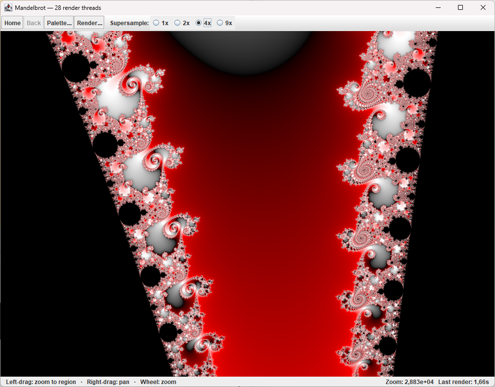

# Mandelbrot

An interactive Mandelbrot and Julia set explorer written in Java (Swing): multithreaded tiled rendering, self-refining super-sampling, a live palette editor, bookmarks, a Julia split view, and a background render queue for high-resolution PNGs.



## What's in it

- **Fast navigation**: drag to zoom, right-drag to pan, wheel to zoom, Home, Back and an exact **Go to…**.
- **Adaptive super-sampling**: a quick 1×1 preview while you move, then it refines on its own once you stop, at up to 8×8 samples per pixel, spent only on the pixels that need them.
- **Palettes**: built-in and your own, with a live editor that recolours the view as you change it.
- **Bookmarks**: a thumbnail grid of saved places, with export and import.
- **Julia sets**: a constant chip with presets, and a **split view** where the pointer on the Mandelbrot set chooses c for the Julia set next to it.
- **Render queue**: pictures up to 8K and beyond are drawn one at a time in the background, so the view stays usable.
- **Remembers where you left off**, in light or dark theme.

How to use all of this: the **[user guide](docs/user-guide.md)**.

## Requirements

- JDK 25
- Maven 3.x

## Building and running

```sh
mvn package
java -jar target/mandelbrot.jar
```

`target/mandelbrot.jar` is self-contained (FlatLaf and Jackson are inside), so it can be copied anywhere and, on most desktops, started with a double-click. Without arguments it opens the window; with arguments it renders from the command line (below). JVM options go before `-jar`, e.g. `java -Dmandelbrot.theme=dark -Xmx4g -jar target/mandelbrot.jar`. You can also run `MandelbrotApp` or `MandelbrotCli` directly from your IDE. Your settings, palettes, bookmarks and renders are kept in `~/mandelbrot`; see the guide.

### Command-line render

Give the jar arguments and it renders a picture without opening the window, from a view saved in the app:

```sh
java -jar target/mandelbrot.jar seahorse.json -o seahorse.png --size 7680x4320 --samples 3
```

The input is an exported bookmark, `bookmarks.json` itself (pick one with `--bookmark`), a view file from the old Save button, or a PNG made by this app (it carries its view inside, so it can be re-rendered larger). Options override what the file says: `--size`, `--samples`, `--fractal`, `--c`, `--re`, `--im`, `--zoom`, `--window`, `--threads`. Run with `--help` for the list. Pictures frame the same area the Render dialog would, and memory use is bounded by the output size.

## Project layout

```
src/main/java/se/karnerfors/mandelbrot/
├── app/       Entry points (Main for the jar, MandelbrotApp, MandelbrotCli), JuliaSplit, SessionRecorder
├── io/        MandelbrotConfig (a "place"), session state, and the stores for bookmarks,
│              palettes and Julia presets
├── math/      Complex numbers and Viewport (center, zoom, pixel ↔ complex mapping)
├── palette/   Palette: colour stops and the gamma-blended gradient built from them
├── render/    Escape-time algorithms (Mandelbrot, Julia), tiled parallel Renderer,
│              IterationGrid, Colorizer, ImageExporter, RenderSettings, render queue
└── ui/        FractalPanel (the live view), top and status bars, popovers, dialogs,
               the palette editor, and the custom-painted controls (Theme, AppButton, …)
```

Rendering has two stages. First, `Renderer` computes escape-iteration counts into an `IterationGrid`. Then `Colorizer` maps those counts through a `Palette` and box-filters the supersampled result down to the output size. Because the stages are separate, changing the palette recolours the existing grid without recomputing the fractal. The coordinate maths sits behind `Viewport`, so a deep-zoom engine could replace the double-precision one later.

Default render settings (max iterations, escape radius, supersample factor) are in `RenderSettings.defaults()`.

## Status

There are no automated tests yet; the plan is in [docs/roadmap.md](docs/roadmap.md), and open problems are in [docs/known-issues.md](docs/known-issues.md).

## Credits and license

The UI uses [FlatLaf](https://www.formdev.com/flatlaf/) and the bundled IBM Plex fonts (SIL Open Font License, see `src/main/resources/fonts/OFL.txt`).

Released under the [MIT License](LICENSE).
